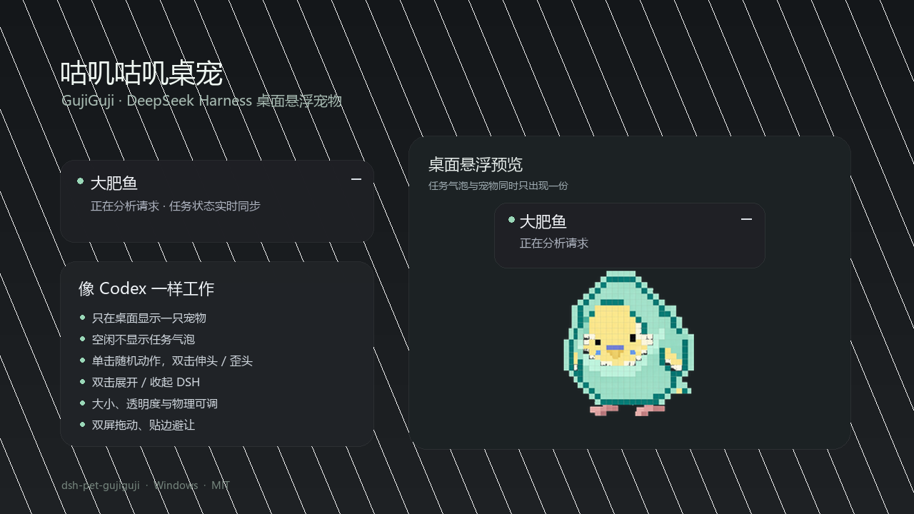

# 咕叽咕叽桌宠（dsh-pet-gujiguji）

给 DeepSeek Harness（DSH）桌面端使用的轻量悬浮桌宠。它不会在 DSH 窗口里再显示一只，只在 Windows 桌面悬浮，展示当前项目名和正在执行的工作内容。



## 功能

- 工作状态浮窗固定在宠物旁，深灰半透明、圆角，项目名在上，当前工作内容在下。
- 长工作内容自动横向循环滚动；空闲时不显示“空闲”或任务浮窗。
- 空闲时每隔 30–75 秒随机播放一次动作，间隔可调到 15–150 秒。
- 单击会随机播放歪头、伸头、展翅或挥翅，每个动作都从站立开始并回到站立。
- 双击在打开或收起 DSH 后，随机播放一次伸头或歪头。
- DSH 任务正常完成后，宠物会连续轻跳两次作为提醒；失败、中断和超限不会误触发。
- 每个动作的头部视觉尺度保持一致，位置可按姿势不同；切换时不跳大小。
- 宠物和状态浮窗都会识别每块显示器的工作区：宠物本体不会被双屏分界切割，浮窗靠近边缘时自动避让。
- 双击会打开或收起 DSH 窗口；如果任务浮窗此前被最小化且任务仍在进行，也会同时恢复。
- 右键打开设置或隐藏宠物；设置窗口本身可调整大小。
- 设置支持宠物大小、透明度、甩出力度、空闲动作间隔、位置锁定和减少动态效果，滑杆与数值输入同步。
- “行为”页可恢复默认位置，避免更换显示器后宠物留在屏幕外。
- 支持双屏及不同缩放比例的 Windows 虚拟桌面，宠物可以拖到另一块屏幕。
- 拖动后松手会自然下落；快速甩动会带速度飞出，并受较轻的重力、空气阻力、墙面反弹和地面摩擦影响。
- 宠物被甩出后会切换为完整的起飞动作，落地后恢复原来的任务动作或站立状态。
- 宠物飞行时任务浮窗暂时隐藏，停止并落地后自动恢复。
- 所有精灵帧共用同一条脚底线，落地不会悬空，也不会裁掉低姿态帧。
- 贴边距离按当前动作外框计算，站立时不再按展翅宽度预留；只有宽动作开始时才临时向内避让。
- 展翅和挥翅直接使用完整原图，不裁切、不旋转翅膀，脸和身体不会混帧。

## 开发计划

拖动、甩出、落地回弹、状态互动和轻量化路线见 [开发计划](docs/DEVELOPMENT-PLAN.zh.md)。

## 安装

### 从 DSH 插件市场

在 DSH 中打开 **插件 → 发现**，搜索 `dsh-pet-gujiguji`，安装后重启 DSH。安装包已带版本化的 `desktop/dsh-pet-gujiguji-<版本>.exe`，通常不需要额外安装 Python。

### 从 npm 安装

```powershell
dsh plugin --profile desktop add dsh-pet-gujiguji
```

安装后重启 DSH。插件 Host 会自动启动 `desktop/pet-window.pyw`。

### 可选：Python 运行方式

插件会优先运行版本号最高的 `desktop/dsh-pet-gujiguji-<版本>.exe`。带版本号的文件名允许新版与正在运行的旧版共存，因此更新时不会强制关闭桌宠。只有删除这些 EXE、改用源码模式时，才需要：

```powershell
py -m pip install Pillow
```

如果 Python 不在 `PATH` 中，可以设置 `DSH_PET_PYTHON` 为 `pythonw.exe` 的完整路径。

## 使用

- 拖动宠物可跨屏移动；开启“锁定位置”后拖动只触发点击逻辑。
- 轻拖后松手会自然落下；快速甩出会飞出、撞墙反弹，并在落地时短暂压缩回弹。
- 宠物飞行期间任务浮窗会自动收起，停稳后恢复。
- 空闲时宠物会以随机间隔自动播放随机动作。
- 单击随机切换歪头、伸头、展翅或挥翅动作。
- 双击打开或收起 DSH；任务进行中且浮窗已最小化时，同时恢复浮窗。
- 双击后还会随机播放一次伸头或歪头反馈。
- 右键选择“设置”调整大小、透明度、物理与行为，或选择“隐藏宠物”。

## 说明

- 当前仅支持 Windows。
- 从旧版升级时，会自动迁移 `dsh-light-feather` 或 `dsh-mint-budgie` 目录中的宠物位置和设置。
- 桌宠进程会读取 DSH Host 写入的 `desktop/state.json`，因此 DSH 与桌宠必须使用同一个插件安装目录。
- 隐藏宠物后，DSH Host 不会自动重新启动它；再次双击 DSH 中的桌宠入口或重新启用插件即可恢复。

## 许可证

MIT
